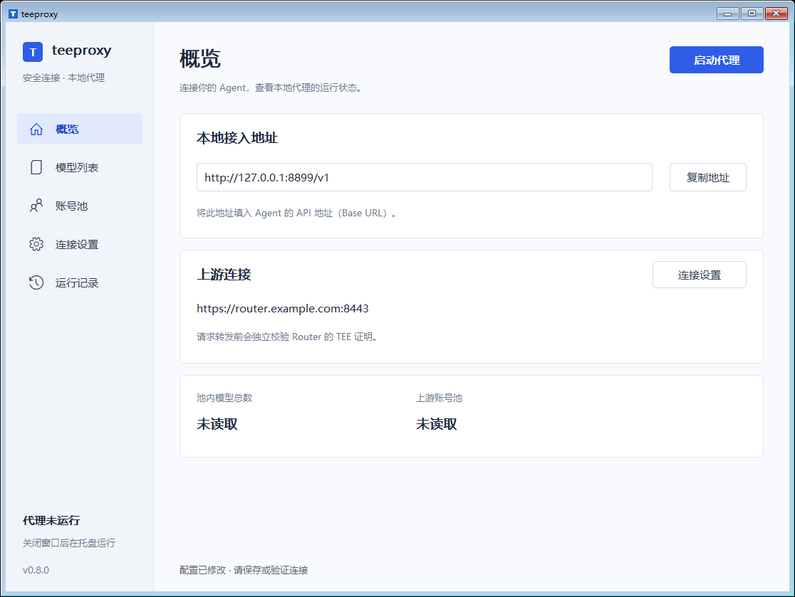

# teeproxy

商户管理程序可使用 `teeproxy merchant-transport --config PATH` 复用同一 TEE 验证器。该模式只接收私有 stdin/stdout JSON 管道，允许 `/merchant/*` 的有限管理接口，不开放本地商户 HTTP 代理，也不允许平台 `/admin/*`。证明及当前 TLS 绑定通过后，才在该连接发送商户凭证。用户桌面模式和本地 agent API 地址保持原样。使用方法见 [teerouter 多商户文档](https://github.com/wangyi160/teerouter/blob/main/docs/MERCHANTS.md)。

给 Codex、Claude Code 等 agent 提供一个本地 API 地址。teeproxy 独立验证 [teerouter](https://github.com/wangyi160/teerouter) 的硬件证明、批准的软件发布和 TLS 绑定，通过之后才向 router 发送密钥和业务请求。

```text
Agent → http://127.0.0.1:8899/v1 → teeproxy → 已验证的 TLS 1.3 → teerouter
```

agent 通过 base URL 直连本机的 teeproxy。默认入口使用回环 HTTP，无需配置本地证书或 HTTP 代理。teeproxy 到 router 的连接始终使用 HTTPS 和独立 TEE 校验。

## Windows 桌面版

双击 `teeproxy.exe` 打开原生 Win32 窗口。左侧导航切换概览、模型列表、账号池、连接设置和运行记录，右侧显示当前页面的详情。在连接设置填写上游 router 的 **HTTPS 根地址**、router key 和审核后的 TDX/SNP 策略文件，可以修改本地端口、账号池及可选本地 key。

- **保存设置**：将设置保存到当前 Windows 用户目录，密钥由 Windows DPAPI 加密。
- **验证连接**：在后台校验真实 router，显示校验结果，不发送业务密钥。
- **启动代理 / 停止代理**：右上角按钮控制本地 API 监听；停止会同时关闭现有连接和响应流。
- **概览**：查看本地 `/v1` 地址、上游地址及模型和账号池数量，点击“复制地址”用于 agent 的 base URL。
- **模型 / 账号池**：按账号池浏览当前 key 可访问的模型，查看商户、倍率、上游账号与可用状态。选择模型后，“使用此池并复制模型”会保存对应账号池并复制模型 ID；切换运行中的账号池须先停止代理。倍率由商户按池设置，1× 表示官方基准价，0.2× 表示其 20%；Workbuddy 使用测试基准。刷新前先通过 TEE 验证。
- **账号池与账号明细**：账号池页采用上下两个联动列表。上方每个池一行，显示商户、倍率、账号数量、供应商和状态；点击池后，下方仅显示该池的账号、可用状态和模型目录。账号数量包含停用账号，空池显示 0。
- **系统托盘**：最小化或关闭窗口后继续转发；点击托盘图标恢复，右键选择“退出 teeproxy”结束程序。

Windows 发行包见 [Releases](https://github.com/wangyi160/teeproxy/releases)。具体操作、配置保存位置和后台行为见 [桌面版说明](docs/DESKTOP.md)。



[连接设置](docs/images/windows-desktop.png) · [模型页](docs/images/windows-models.png) · [账号池页](docs/images/windows-accounts.png)。截图使用示例地址；连接并刷新后显示当前 key 可访问的真实数据。

## 源码构建和命令行

```sh
cargo build --release --locked
cp teeproxy.example.toml teeproxy.toml
```

Windows 构建需要 Windows SDK（MSVC）或 MinGW 资源编译器。`cargo build --release --locked --all-features` 同时启用 TDX 和 SNP。Windows 无参数运行打开桌面窗口；以下命令行接口继续可用。桌面版直接在窗口里配置，无需编辑 TOML 或设置密钥环境变量。

在 `teeproxy.toml` 填写 router 的 HTTPS 根地址和自己审核的 `tdx_policy` 或 `snp_policy`。相对路径以配置文件所在目录为基准。示例策略为空，启动会拒绝；策略建立方法见 [证明与策略](docs/ATTESTATION.md)。

向 teeproxy 的启动环境提供普通业务 key `TEEPROXY_ROUTER_KEY`，然后执行：

```sh
./target/release/teeproxy verify --config teeproxy.toml
./target/release/teeproxy run --config teeproxy.toml
```

`verify` 不读取 router key，也不发送业务请求。`run` 默认监听 `127.0.0.1:8899`。每个新建 router 连接都必须通过验证；已验证连接最多在 120 秒内复用，过期重新验证，正在进行的流可继续完成。

默认包含 Intel TDX/dstack 验证。AMD SEV-SNP 使用 `cargo build --release --locked --features snp-verifier`，还需要编译 vendored OpenSSL 所需的 C 工具链和 Perl。

## 连接 agent

| 客户端 | API 地址设置 |
| --- | --- |
| Codex / OpenAI 兼容客户端 | `http://127.0.0.1:8899/v1` |
| Claude Code | `ANTHROPIC_BASE_URL=http://127.0.0.1:8899`，SDK 自动添加 `/v1/messages` |
| Gemini 兼容客户端 | 将 API 根地址指向 `http://127.0.0.1:8899`，调用 `/v1beta/models/...` |

Codex：将 [provider 示例](examples/codex.config.toml) 合并到用户配置，设置 `TEEPROXY_AGENT_KEY=teeproxy-local`，再运行 `codex --profile teeproxy --model <router模型ID>`。示例使用 HTTP Responses/SSE。

Claude Code：设置上述 `ANTHROPIC_BASE_URL` 和 `ANTHROPIC_API_KEY=teeproxy-local`，运行 `claude --model <router模型ID>`。

agent 的占位 key 会被移除。真实 router key 由 teeproxy 管理，agent 无需持有；如设置了桌面版的本地 key 或命令行的 `client_key_env`，agent 应改用该独立本地 key。完整 PowerShell 命令、认证和版本迁移见 [客户端接入](docs/CLIENTS.md)。

## 行为和范围

- 原样转发允许接口的方法、路径、查询参数、JSON 字节和兼容头；不修改模型、prompt、tools 或 tool_choice。
- 清理逐跳头、agent 认证和 Cookie，设置 router key；可用配置中的 `pool` 选择账号池。
- 响应状态和数据逐块转发，支持 SSE；取消、错误或超时关闭对应上游连接。已发出的请求不会自动重放。
- 仅监听本机回环地址，核对 Host 和端口，拒绝浏览器跨域请求、CONNECT、代理形式的目标 URL、管理接口和 URL 凭证。
- 支持模型/账号池/用量查询、Chat Completions、Responses、Messages、Gemini 生成以及经验证的 router 健康查询。
- 请求体及 gzip 解压后均限制为 2 MiB，默认 16 个并发请求和 128 个客户端连接，流空闲超时默认 120 秒。

当前不支持 WebSocket、远程 compaction、Claude token-counting 接口或协议转换。agent 的具体功能取决于 router 提供的接口与模型；不会伪造未实现接口的成功响应。部署和本机信任边界见 [安全说明](docs/SECURITY.md)。

## 验证

```sh
cargo test --locked
cargo test --locked --all-features
cargo clippy --locked --all-targets --all-features -- -D warnings
cargo fmt --all -- --check
```

测试涵盖本地 API 直连、认证隔离、同一 TLS 通道、拒绝未验证证据、SSE、取消与超时、gzip、主机和路径限制，以及公开 Intel/AMD 签名样本的篡改、过期和策略校验。成功通道测试的模拟验证入口仅存在于 `cfg(test)`，发行二进制没有跳过验证的选项。真实云实例和具体 agent 版本仍需接入验收。

可选 [CI 模板](ci/github-actions.yml) 可放入 `.github/workflows/ci.yml`；提交该路径需要 GitHub workflow 写权限。

许可证：[MIT](LICENSE)。验证代码和测试材料来源见 [NOTICE](NOTICE)。
